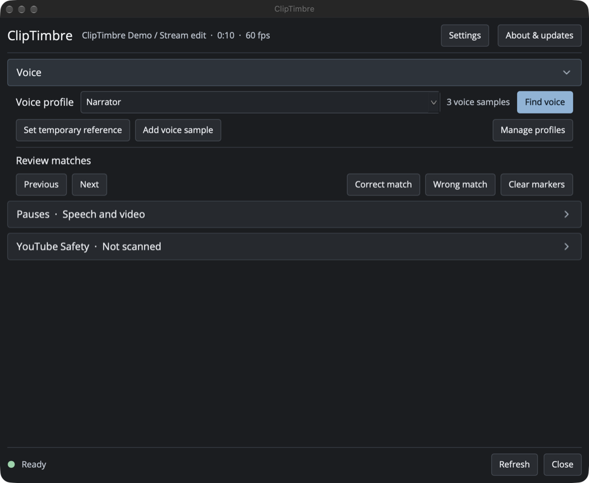

# ClipTimbre for DaVinci Resolve

A DaVinci Resolve Studio panel for finding a selected voice, shortening pauses and reviewing dialogue before export. Audio processing runs locally.

[Русский](README.ru.md) · [GitHub](https://github.com/0xDive/cliptimbre) · [Releases](https://github.com/0xDive/cliptimbre/releases) · [Telegram](https://t.me/dev_dive)

[Settings screenshot](docs/screenshots/settings.png)

## Install and uninstall

Install **DaVinci Resolve Studio 21** and **Python 3.12** (**3.11** on Intel Macs). On Windows on Arm, use x64 Python. Close Resolve before installing or uninstalling.

For a tagged version, follow the instructions on its release page. To use this checkout, run the matching command from this directory.

| Platform | Install | Uninstall |
| --- | --- | --- |
| macOS | `bash ./install_macos.sh` | `bash ./uninstall_macos.sh` |
| Windows | `.\install_windows.cmd` | `.\uninstall_windows.cmd` |
| Linux | `bash ./install_linux.sh` | `bash ./uninstall_linux.sh` |

Start Resolve and open **Workspace → Scripts → ClipTimbre**. The first install downloads Python packages. Speaker recognition and transcription download model weights on first use.

Installation preserves existing settings and voice profiles. Uninstall removes the menu item and keeps local data and the Python runtime. Fresh Windows and Linux installs use CPU PyTorch wheels by default. Pass `--pytorch-index URL` to install a compatible GPU build. Fresh Apple Silicon installs include MLX Whisper.

On Linux, use `zenity` for dialogs. Ripple Delete inside clips requires X11 and `xdotool` on Linux, and Accessibility permission on macOS. The panel was tested in Resolve Studio 21.0.4 on macOS. Windows and Linux still need testing in Resolve. [Studio feature matrix](https://documents.blackmagicdesign.com/SupportNotes/DaVinci_Resolve_Studio_21_Features.pdf)

## Use

Click a section header to expand or collapse its tools.

1. **Voice.** Select a voice profile or create one under **Manage profiles**. Save samples in the active profile or set a temporary reference from the playhead. **Find voice** marks matches, including short speech windows. **Correct match** and **Wrong match** calibrate the profile threshold.
2. **Pauses.** After finding matches, mark and review pauses before running **Tighten pauses**. Long pauses, uncertain speakers and cuts near voice-region boundaries are marked for manual review. Tightening creates a timeline backup by default and uses native Ripple Delete at clip boundaries.
3. **Video playback.** In **Pauses**, choose the video track and select **Mark possible video pauses**. In supported file-backed clips, the scan marks still intervals of at least 1.2 seconds followed by motion. Use **Crop %** as `x,y,width,height` to scan only the video area in a recording with a webcam overlay. The paired markers are candidates for review.
4. **YouTube Safety.** Scan the current timeline with local Whisper transcription. Select a flagged phrase to read its context. Uncertain transcriptions and clusters of repeated profanity are marked for manual review. **Edit risk rules** opens the local dictionary, which you can customize.
5. **Auto Censor.** Choose **Beep**, **Smooth Mute** or **Timeline Mute** to create a processed timeline copy from eligible findings. Timeline Mute keeps separate tracks and adds fades when audio can be mapped to the source. Keep the generated WAV files while the project references them.

**Settings → Diagnostics → Open data folder** opens the settings and reports. Set `"audio_source_mode": "render"` in `config.json` to analyze the processed Resolve mix.

Open **About & updates** in the top-right corner of the panel. **Check for updates** compares your installed version with the latest stable GitHub release. The panel remembers the result and shows **Update available** in the header when it finds a newer version. **Open release** opens downloads and installation instructions. **Project links** contains shortcuts to GitHub and Telegram.

## Development and releases

`backend/` contains audio processing, `resolve_lua/` contains the panel and timeline integration, and `install.py` manages installation. Run `python -m unittest discover -s tests` for installer tests.

GitHub Actions checks pull requests and pushes to `main`. For a new release, update `VERSION`, commit the change, then tag and push the matching version as `vX.Y.Z`. After the checks pass, GitHub publishes the release with notes generated from the commit history and links to the source downloads.

## License

[AGPLv3](LICENSE) · [DaVinci Resolve interoperability permission](LICENSE-RESOLVE-EXCEPTION.md) · [Tabler Icons (MIT)](resolve_lua/icons/LICENSE)
