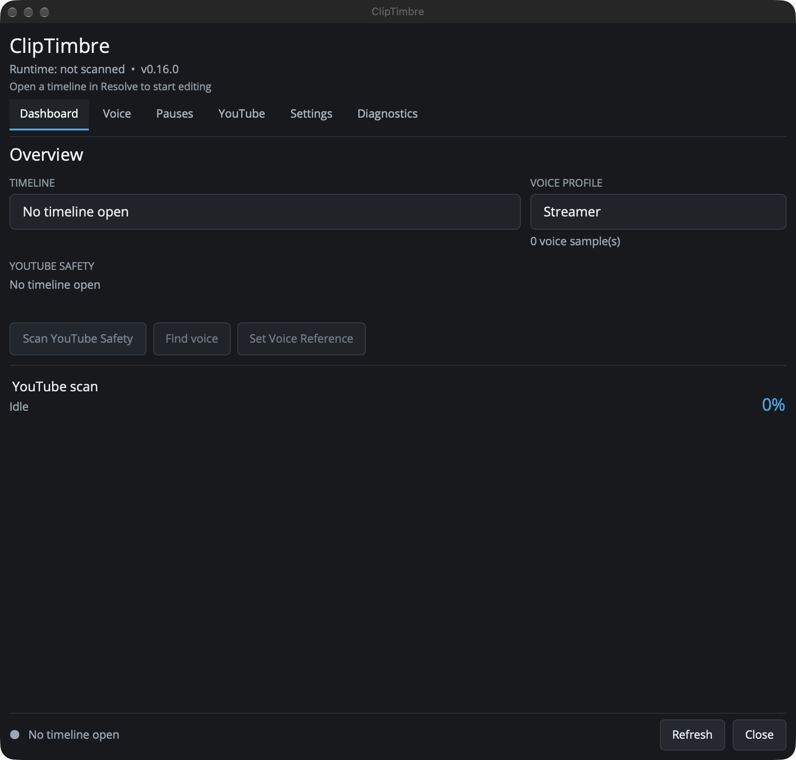

# ClipTimbre для DaVinci Resolve

Панель для DaVinci Resolve Studio, которая находит выбранный голос, сокращает паузы и помогает проверить диалоги перед экспортом. Аудио обрабатывается локально.

[English](README.md) · [GitHub](https://github.com/0xDive/cliptimbre) · [Релизы](https://github.com/0xDive/cliptimbre/releases) · [Telegram](https://t.me/dev_dive)

[Скриншот настроек](docs/screenshots/settings.png)

## Установка и удаление

Установите **DaVinci Resolve Studio 21** и **Python 3.12** (**3.11** на Intel Mac). На Windows on Arm используйте x64-версию Python. Перед установкой или удалением закройте Resolve.

Для версии с тегом следуйте инструкции на странице её релиза. Для текущей копии репозитория запустите подходящую команду из этой папки.

| Платформа | Установка | Удаление |
| --- | --- | --- |
| macOS | `bash ./install_macos.sh` | `bash ./uninstall_macos.sh` |
| Windows | `.\install_windows.cmd` | `.\uninstall_windows.cmd` |
| Linux | `bash ./install_linux.sh` | `bash ./uninstall_linux.sh` |

Запустите Resolve и выберите **Workspace → Scripts → ClipTimbre**. При первой установке загрузятся пакеты Python. Распознавание голоса и транскрибация загрузят модели при первом запуске.

Установка сохраняет существующие настройки и голосовые профили. Удаление убирает пункт меню и сохраняет локальные данные и окружение Python. При новой установке на Windows и Linux по умолчанию используется CPU-версия PyTorch. Передайте `--pytorch-index URL` для установки совместимой сборки с поддержкой GPU. На Apple Silicon при новой установке добавляется MLX Whisper.

На Linux используйте `zenity` для диалогов. Для Ripple Delete внутри клипов на Linux нужны X11 и `xdotool`, а на macOS — разрешение «Универсальный доступ». Панель проверена в Resolve Studio 21.0.4 на macOS. Windows и Linux ещё предстоит проверить в Resolve. [Возможности Studio](https://documents.blackmagicdesign.com/SupportNotes/DaVinci_Resolve_Studio_21_Features.pdf)

## Использование

Нажмите на заголовок раздела, чтобы раскрыть или свернуть его инструменты.

1. **Voice.** Выберите голосовой профиль или создайте его через **Manage profiles**. Запишите образцы в активный профиль или задайте временный образец с позиции курсора. **Find voice** размечает совпадения, в том числе в коротких фрагментах речи. **Correct match** и **Wrong match** калибруют порог профиля.
2. **Pauses.** После поиска совпадений разметьте и проверьте паузы перед запуском **Tighten pauses**. Длинные паузы, участки с неподтверждённым голосом и паузы у границ речи отмечаются для ручной проверки. Команда сокращения по умолчанию создаёт копию таймлайна и использует нативный Ripple Delete на границах клипов.
3. **Video playback.** На вкладке **Pauses** выберите видеодорожку и нажмите **Mark possible video pauses**. В поддерживаемых клипах поиск отмечает неподвижные участки от 1,2 секунды, после которых возвращается движение. Через **Crop %** задайте область `x,y,ширина,высота` в процентах, чтобы исключить веб-камеру. Пары меток служат для ручной проверки.
4. **YouTube Safety.** Запустите локальную транскрибацию текущего таймлайна через Whisper и выберите фразу, чтобы увидеть её контекст. Кнопка **Rebuild markers** ставит метки по сохранённому отчёту без повторной транскрибации. Ненадёжное распознавание и интервалы с частыми ругательствами помечаются для ручной проверки. Локальный словарь можно настроить через **Edit risk rules**.
5. **Auto Censor.** Выберите **Beep**, **Smooth Mute** или **Timeline Mute**, чтобы создать обработанную копию таймлайна по подходящим находкам. Timeline Mute сохраняет раздельные дорожки и добавляет плавные переходы, если аудио можно сопоставить с исходником. Сохраняйте созданные WAV-файлы, пока проект на них ссылается.

**Settings → Diagnostics → Open data folder** открывает настройки и отчёты. Чтобы анализировать обработанный микс Resolve, задайте `"audio_source_mode": "render"` в `config.json`.

Откройте **About & updates** в правом верхнем углу панели. Кнопка **Check for updates** сравнивает установленную версию с последним стабильным релизом на GitHub. Панель запоминает результат и показывает **Update available** в шапке, если найдена новая версия. Кнопка **Open release** открывает загрузки и инструкции по установке. Ссылки на GitHub и Telegram находятся в блоке **Project links**.

## Разработка и релизы

В `backend/` находится обработка аудио, в `resolve_lua/` — панель и интеграция с таймлайном. За установку отвечает `install.py`. Команда `python -m unittest discover -s tests` запускает тесты установщика.

GitHub Actions проверяет пул-реквесты и пуши в `main`. Для нового релиза обновите `VERSION`, сделайте коммит, поставьте соответствующий тег `vX.Y.Z` и отправьте его на GitHub. После успешных проверок GitHub опубликует релиз со списком изменений из истории коммитов и ссылками на исходники.

## Лицензия

[AGPLv3](LICENSE) · [Разрешение на интеграцию с DaVinci Resolve](LICENSE-RESOLVE-EXCEPTION.md) · [Tabler Icons (MIT)](resolve_lua/icons/LICENSE)
